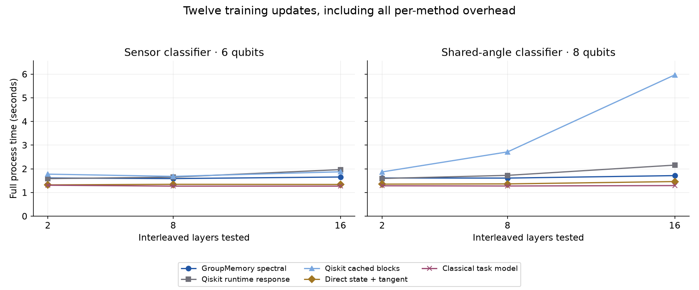
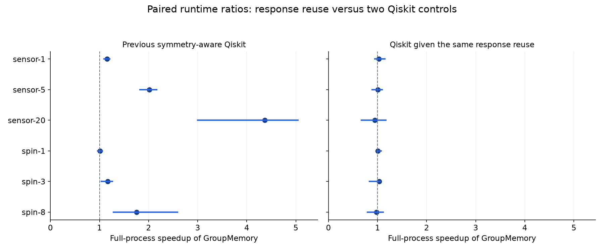
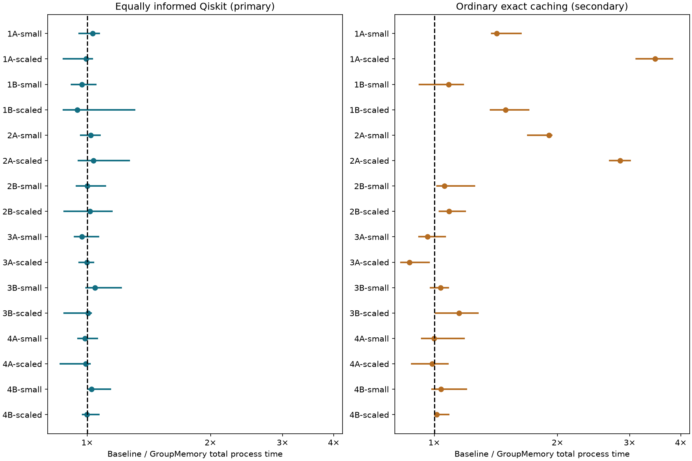
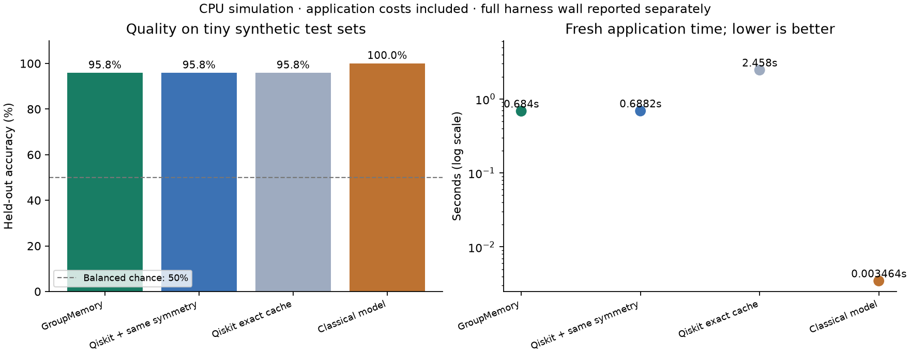

# GroupMemory QML

**Reuse equivalent computations in small quantum machine learning experiments—and measure whether the bookkeeping pays for itself.**

GroupMemory is an experimental **classical cache around quantum computations**. The original demo supports a symmetric ring circuit and known rotations and reflections of its inputs. The eight-experiment suite extends this to valid derivative shifts, quantum kernels, image patches and exact local subcircuits. It does not discover the symmetry of arbitrary circuits.

The runnable sensor classifier compares:

| Method | What it can reuse |
|---|---|
| GroupMemory | Exact inputs and symmetry-equivalent inputs, using a dictionary |
| Symmetry-aware Qiskit | The same symmetry and canonical jobs, using a vectorized unique table |
| Exact-cache Qiskit | Exact repeated inputs, without symmetry-based reuse |
| Classical model | Fourier power and circular-correlation features with logistic regression |

**The equally informed Qiskit implementation is the primary baseline.** In the original experiment, GroupMemory substantially reduced work relative to exact-input caching, but did not show a reliable advantage over symmetry-aware Qiskit. The classical model was faster and at least as accurate. This repository makes that result inspectable and reproducible.

## Try it

Use Python 3.11 or newer. Package installation needs an internet connection; the demo itself generates its data locally and needs no account, credentials, downloads, or QPU access.

```bash
git clone https://github.com/BoredDuffa/group-memory-qml.git
cd group-memory-qml
python -m venv .venv
source .venv/bin/activate
python -m pip install -e '.[dev]'

python -m group_memory_qml.demo --output results/quickstart
pytest
```

On Windows, activate with `.venv\Scripts\activate` instead. The quickstart uses six qubits, one data seed, one timing repeat, and three quantum parameter updates. A small local CPU run is sufficient; runtime depends on your machine.

Run the larger sensor comparison explicitly:

```bash
python -m group_memory_qml.demo \
  --qubits 10 \
  --seeds 846101 846102 846103 \
  --repeats 2 \
  --output results/my-run
```

The command writes a new results directory with `summary.md`, `summary.csv`, accuracy/runtime and learning plots, full `results.json`, `validation.json`, `environment.json`, and `wall_accounting.json`. It refuses to overwrite a nonempty directory. For an interactive walkthrough, open [the sensor classifier notebook](examples/sensor_classifier.ipynb). Existing saved results are evidence, not a substitute for running the command on your machine.

Use `--broken-symmetry` with a new output directory to make the circuit's site gains unequal and verify that orbit reuse is disabled. `python -m group_memory_qml.demo --help` lists the bounded run options.

## Real smartphone sensor data — 2026-10-20

**GroupMemory beats equally informed Qiskit in all three measured conditions,
including full process overhead, but does not beat the task-specific classical
classifiers on speed or accuracy.** It also beats direct classical adjoint
training of the identical quantum model in the two 512-example conditions;
the adjoint is faster in the 128-example condition.

The benchmark uses real [UCI smartphone activity data](https://archive.ics.uci.edu/dataset/240/human+activity+recognition+using+smartphones),
128 or 512 training examples, 128 validation examples and 256 test examples.
Train/validation/test subjects are disjoint within each seed. Five seeds and two
timing repeats cover six methods: **180/180 successful attempts**.
The model has **8 or 16 independently trained quantum angles**, plus a jointly
trained softmax head. Its independent two-qubit patches can be evaluated on two
qubits sequentially; this is not a globally entangled 16-qubit benchmark.

| Training examples / quantum parameters | Method | Total process time | Test balanced accuracy |
|---|---|---:|---:|
| 128 / 8 | GroupMemory | 2.234 s | 59.06% |
| 128 / 8 | Equally informed Qiskit | 3.960 s | 59.06% |
| 128 / 8 | Same-model adjoint | 2.008 s | 59.06% |
| 128 / 8 | Logistic regression | 1.626 s | 87.80% |
| 128 / 8 | RBF SVM | 1.587 s | 87.34% |
| 128 / 8 | Classical MLP | 1.632 s | 84.91% |
| 512 / 8 | GroupMemory | 2.645 s | 57.59% |
| 512 / 8 | Equally informed Qiskit | 6.757 s | 57.59% |
| 512 / 8 | Same-model adjoint | 2.982 s | 57.59% |
| 512 / 8 | Logistic regression | 1.826 s | 92.08% |
| 512 / 8 | RBF SVM | 1.762 s | 92.53% |
| 512 / 8 | Classical MLP | 1.804 s | 85.87% |
| 512 / 16 | GroupMemory | 3.227 s | 58.50% |
| 512 / 16 | Equally informed Qiskit | 11.579 s | 58.50% |
| 512 / 16 | Same-model adjoint | 4.629 s | 58.50% |
| 512 / 16 | Logistic regression | 1.944 s | 92.08% |
| 512 / 16 | RBF SVM | 1.855 s | 92.53% |
| 512 / 16 | Classical MLP | 2.011 s | 91.30% |

Times are medians of seed medians; balanced accuracies are means across the five
seeds. Timing repeats do not create new test samples. GroupMemory's median paired
time savings against Qiskit are **42.9%, 60.4% and 72.1%** in table condition order.
The paired calculation differs from the ratio of marginal medians shown above.
A descriptive runtime win requires five complete paired seeds, two matching
repeats each, every seed median faster and median saving at least 5%.
A useful win over a classical control also requires no lower balanced accuracy
for every paired seed. There are **0/9 such wins** against the classical classifiers.
These are observed comparisons on overlapping subsets of one dataset, not
confidence intervals or universal performance claims.

The implementations use the same exact patch factorization and response support.
Qiskit receives the same cached diagonal blocks, compiler reuse, exact input keys,
response lifetime, validation-response warmup and off-grid correctness checks.
GroupMemory computes coefficients directly and reuses them across updates.
The adjoint is a direct classical implementation of the identical model.
Each classical learner fits both the same compressed inputs and all 561 released
features, selects the feature view by validation log loss, and pays for both fits.
Hyperparameters were fixed before the final campaign; test data does not select
models, views or checkpoints. MLP angle-view fits reached the 200-iteration
limit and emitted convergence warnings, including some selected fits; these
are retained as bounded fits. Classical controls may select all 561 features,
so the task comparison also involves different input representations.

**Learning is above the 16.7% chance baseline, but substantially weaker than the
classical classifiers.** All independent angles moved. More data/parameters did
not improve this quantum model's mean accuracy consistently. All selected quantum
checkpoints occur at the 60-update limit, so this is a bounded training result,
not a convergence or optimized-accuracy claim. Increasing 8 to 16 parameters also
changes PCA input width and head width. GroupMemory preserves the model's
predictions; faster reuse does not by itself improve predictive quality. No
frozen-quantum-feature ablation isolates the benefit of adapting the quantum
angles from training the classical head.

All 30 complete matched blocks passed the unchanged `1e-10`
trajectory/prediction tolerance; maximum error was **9.21e-15**.
**540 local tests passed.** The main campaign took **9.54 minutes**.
Per-method times include fresh interpreter startup, imports, prepared-data read
and verification, train-only preprocessing, construction/compilation,
calibration/checks, caching, training/validation/selection, prediction,
serialization and exit. The common dataset acquisition/preparation component
sum was **29.56 seconds**; standalone cold-start
illustrations add it once. No single external acquisition clock was recorded.
Original authors' sensor feature extraction, installation and implementation
are excluded. Preflight, pilot, parent orchestration, audit and report costs
are separately retained in the timing ledger. Pilot results are not pooled.

This is ideal local CPU simulation. It establishes no QPU, physical gate/shot,
energy, hardware training or practical quantum-learning advantage. UCI's current
listing and the older bundled README differ on data licensing; provenance
preserves both statements, and raw data is not redistributed.

- [Reproduction commands and scope](docs/real_sensor.md)
- [Executed notebook](examples/real_sensor_benchmark.ipynb)
- [All results](results/real-sensor/summary.csv), [paired comparisons](results/real-sensor/comparisons.csv), and [independent audit](results/real-sensor/independent_audit.json)
- [Raw attempts](results/real-sensor/raw_attempts.zip), [frozen sources](results/real-sensor/source_snapshot.zip), and [timing ledger](results/real-sensor/wall_accounting.json)

Historical benchmarks below use different data and models; their timings are
kept separate from this real-data campaign.

## Larger statevectors and independent trainable angles — 2026-10-20

**GroupMemory meets the descriptive runtime-win rule in 6 of eight conditions against the faster of two equally informed Qiskit controls.**

The new implementation propagates multivariate Fourier coefficients through local
gates, avoiding dense fixed-block matrices. The Qiskit controls also cache the
CZ/RZ diagonal blocks and use Aer runtime binding: one reconstructs the same
response, while the other computes exact occurrence-shift gradients directly.
The comparison gives Qiskit the faster control separately for each paired seed.

The eight conditions use **8, 12 or 14 qubits**, **1, 2 or 4 independently
trainable angles**, eight interleaved trainable-gate layers and 12 updates.
Four-angle cases reach 12 qubits; the 14-qubit case uses two angles.
Each method trains on just **four synthetic examples**. Sensor evaluation has
four held-out examples from two related pairs; shared-task evaluation has
16 held-out examples. These are deliberately small runtime/memory scaling
fixtures; accuracy does not establish practical learning or generalization.

| Task, qubits, independent angles | GroupMemory | Faster Qiskit | Direct adjoint | Classical task model | Paired speedup | QML / classical accuracy |
|---|---:|---:|---:|---:|---:|---:|
| Sensor, 8q, p=1 | 1.583 s | 1.523 s | 1.257 s | 1.222 s | 1.032× | 100.00% / 100.00% |
| Sensor, 8q, p=2 | 1.505 s | 1.686 s | 1.260 s | 1.216 s | 1.077× | 100.00% / 100.00% |
| Sensor, 8q, p=4 | 1.491 s | 1.773 s | 1.255 s | 1.208 s | 1.133× | 100.00% / 100.00% |
| Sensor, 12q, p=2 | 1.853 s | 2.147 s | 1.668 s | 1.223 s | 1.159× | 100.00% / 100.00% |
| Sensor, 12q, p=4 | 2.620 s | 3.317 s | 1.973 s | 1.405 s | 1.217× | 100.00% / 100.00% |
| Sensor, 14q, p=2 | 3.284 s | 4.116 s | 3.336 s | 1.241 s | 1.264× | 100.00% / 100.00% |
| Shared, 12q, p=2 | 1.925 s | 2.188 s | 1.713 s | 1.208 s | 1.160× | 90.00% / 100.00% |
| Shared, 12q, p=4 | 2.372 s | 3.058 s | 1.968 s | 1.540 s | 1.305× | 90.00% / 100.00% |

Times are medians of seed medians. The Qiskit column takes the median of the
faster Qiskit time selected separately per seed. Paired speedups use those same
seeds and can differ from ratios of displayed times. Accuracy is averaged across
seeds; the same-model outputs, every gradient and full training trajectories
are checked at `1e-10`, rather than accepting matching accuracy alone.

Qualifying conditions: `sensor-n8-p4`, `sensor-n12-p2`, `sensor-n12-p4`, `sensor-n14-p2`, `shared-n12-p2`, `shared-n12-p4`. Conditions without a qualifying result:
`sensor-n8-p1`, `sensor-n8-p2`. Incomplete five-seed coverage: none.
A descriptive win requires at least five complete paired seeds, all three
matching repeats per seed, every seed median faster, and at least 5% median
paired saving. This is an observed-workload rule, not a confidence interval
or a universal crossover claim.

The direct identical-model adjoint has a lower median time in
**7/8** conditions; the task-specific
classical learner does in **8/8**.
GroupMemory meets the same descriptive rule against its batched-grid ablation
in **6/8** conditions. These controls separate
response reuse, ordinary batching and the cost of simulating the model.

**Complete coverage:** 720/720 successful
attempts and 120/120 passing
matched comparisons; maximum absolute trajectory error
**1.77e-14**, against **`1e-10`**.
All **448 local tests passed**.
There are 0 unattempted records; any errors, timeouts and
missing coverage remain in the saved report. Five fresh data seeds and three
repeats use serial, fresh worker processes on the local Apple M1.

The process clock includes startup, imports, data preparation, circuit and
diagonal construction, compilation, response calibration, native verification,
cache bookkeeping, every training update, head fitting, prediction,
serialization and shutdown. Worker clocks sum to
**40.43 minutes**; the last parent invocation took
**40.46 minutes**. The
[timing ledger](results/multi-parameter/wall_accounting.json) separately records
preflight (28.20 seconds), pilots, orchestration and
reporting. Installation and development are excluded. The
101 preliminary native-only attempts are
preserved separately and excluded from these timings and comparisons.

This is **ideal CPU simulation**, with no QPU execution, physical CNOT/shot
saving claim, or practical ML/LLM training result. Local gates remove dense
`4^n` operators, but states still cost `2^n` storage. Independent angles expand
the exact response grid: at eight occurrences it has 17, 81 and 625 points
for one, two and four angles respectively. More parameters can erase reuse's
benefit. Resource guards fail explicitly rather than approximate the response.

- [Method, scope and reproduction commands](docs/multi_response.md)
- [Executed results notebook](examples/multi_parameter_scaling.ipynb)
- [Complete results and negative cases](results/multi-parameter/summary.md), [strongest Qiskit comparisons](results/multi-parameter/strongest_qiskit.json), and [independent audit](results/multi-parameter/independent_audit.json)
- [Raw attempts](results/multi-parameter/raw_attempts.zip), [frozen sources](results/multi-parameter/source_snapshot.zip), and [resource limits](results/multi-parameter/resource_limits.json)

The historical results below use different workloads and controls; their
timings are not pooled with this campaign.


## Deeper circuits with equally informed response controls — 2026-10-20

**GroupMemory now meets the descriptive runtime-win rule in three of six workloads
against the faster of two Qiskit response controls, including all per-method overhead.**
The new engine propagates Fourier state coefficients through repeated fixed blocks,
then caches the exact output function and its derivative across training updates.
Both Qiskit controls receive the same response degree, cache lifetime and correctness
checks. One uses native L3 circuits with fast Aer runtime binding; the other also
receives the same cached block matrices.

These are new interleaved circuits with **one shared trainable angle**, a classical
classifier head, and 12 training updates. They use 6 qubits for sensor classification
and 8 for shared-weight training. Layers alternate fixed noncommuting blocks and
trainable rotations; depth is not inflated with identity pairs.

| Workload | GroupMemory | Qiskit native response | Qiskit cached blocks | Direct state/tangent | Classical task model | Same-model accuracy |
|---|---:|---:|---:|---:|---:|---:|
| Sensor, 2 layers | 1.611 s | 1.585 s | 1.775 s | 1.320 s | 1.306 s | 53.75% |
| Sensor, 8 layers | 1.588 s | 1.649 s | 1.681 s | 1.346 s | 1.269 s | 95.00% |
| Sensor, 16 layers | 1.654 s | 1.967 s | 1.874 s | 1.339 s | 1.268 s | 71.25% |
| Shared, 2 layers | 1.612 s | 1.591 s | 1.869 s | 1.353 s | 1.283 s | 100.00% |
| Shared, 8 layers | 1.608 s | 1.723 s | 2.714 s | 1.363 s | 1.274 s | 97.50% |
| Shared, 16 layers | 1.713 s | 2.156 s | 5.968 s | 1.462 s | 1.292 s | 100.00% |

Times are medians of seed medians, enclosing fresh-process startup, imports, data,
operator construction, compilation, calibration and checks, caching, training,
prediction, serialization and shutdown. The local Apple M1 benchmark used five
fresh data seeds, three repeats and one thread per sequential worker. Seeds vary
the data, not the fixed circuit architecture.

Selecting the faster Qiskit control separately for each seed gives qualifying
paired speedups of **1.168× for 16-layer sensors**, **1.070× for 8-layer shared
training**, and **1.236× for 16-layer shared training**: respectively **14.4%,
6.5% and 19.1% less time**. The other three workloads fail the rule. A descriptive
win requires all five seed medians faster, three matching repeats each, and at
least 5% median paired saving. These are observed results, not confidence intervals
or a universal crossover. Paired ratios need not equal ratios of displayed times.

**The spectral engine did not establish an advantage over the simpler batched-grid
ablation:** none of the six conditions establishes an additional qualifying
spectral win over batching.
The evidence supports specialized classical response construction, without
isolating coefficient sharing as the cause of every speed gain. The identical-model
direct state/tangent control has a lower median time in all six conditions.
The task-specific classical model achieves 100% accuracy throughout. Deeper sensor
circuits do not consistently learn better.

All **540/540 attempts** and **90/90 matched training comparisons** passed, with
maximum trajectory error **6.69e-14** against the unchanged **1e-10** tolerance.
All **274 local tests** passed. The full measurement campaign took **17.11 minutes**;
tests, the separate checkpoint/resume pilot, quick smoke run and reporting have
separate timing receipts. Installation and development are excluded. An Aer 0.17.2
fixture required writable copies of cached unitary buffers; this repair is tested
and its setup cost is included.

This is ideal **CPU simulation**, with no physical CNOT savings or QPU advantage.
Dense operators require exponential storage in qubit count; the implementation
does not scale this approach to hundreds of general entangled qubits.

```bash
python -m group_memory_qml.deep_suite run \
  --conditions benchmarks/deep_quick.json \
  --output results/deep-quick-local \
  --seeds 942001 --repeats 1 --budget-seconds 300
python -m group_memory_qml.deep_report results/deep-quick-local
```

The quick command validates functionality, not a performance claim.

- [Method, equations, limits and full reproduction command](docs/deep_response.md)
- [Executed results notebook with independent raw-record audit](examples/deep_response_results.ipynb)
- [All comparisons and ablations](results/deep-response/summary.md), [strongest-control comparison](results/deep-response/strongest_control_comparisons.json), and [independent audit](results/deep-response/independent_audit.json)
- [Raw attempts](results/deep-response/raw_attempts.zip), [frozen source snapshot](results/deep-response/source_snapshot.zip), and [full timing ledger](results/deep-response/wall_accounting.json)



Both panels share the same vertical scale. Historical results below use different
architectures and workloads and are not pooled with this benchmark.

## Reusing computations across training updates

The new response engines cache an **exact function of the trainable weights**.
For the supported sensor circuit, four coefficients describe each local output;
the shared-weight spin circuit needs two. Native Qiskit/Aer probes determine the
coefficients, and an additional off-grid execution checks them at `1e-10`.
Later updates reuse both the response and its analytic derivatives.

This path is specific to the documented shallow architectures. Unsupported
cases use conservative fallbacks. Both architectures also have inexpensive
classical formulas, which are included as identical-model controls.
Read [the derivations, prior work and limits](docs/parameter_response.md).

```bash
python -m group_memory_qml.response_suite run \
  --conditions benchmarks/response_quick.json \
  --output results/response-quick-local \
  --seeds 940101 --repeats 1 --budget-seconds 300
python -m group_memory_qml.response_report results/response-quick-local
```

The six controls include the previous GroupMemory and symmetry-aware Qiskit
implementations, both new response implementations, the analytic identical
model, and the original classical task model. The response-aware Qiskit control
receives the same basis, probes, checks and cache lifetime. The short command
checks functionality; it does not have enough repetitions for a performance claim.

## Parameter-response reference result — 2026-10-20

**Response reuse improves on the previous symmetry-aware Qiskit baseline; Qiskit given the same response reuse matches it.** All 540 attempts completed, all 90 same-model comparison blocks passed at the unchanged `1e-10` tolerance (maximum error `3.62e-14`), and 153 local tests passed. The independent checkpoint/resume pilot completed all 36 attempts.

The main benchmark took **15.73 minutes**, including its parent process. Per-method times below include fresh-process startup, imports, data, compilation, every calibration/check circuit, cache planning, training, predictions, serialization and shutdown. Each condition has five fresh data seeds and three timing repeats on the local Apple M1, with one thread per worker.

| Workload | New GroupMemory | Previous symmetry Qiskit | Qiskit + response | Analytic identical model | Paired speedup vs previous Qiskit | Same-model accuracy |
|---|---:|---:|---:|---:|---:|---:|
| sensor-1 | 1.696 s | 1.990 s | 1.743 s | 1.256 s | 1.15× | 86.25% |
| sensor-5 | 1.853 s | 3.560 s | 1.854 s | 1.290 s | 2.01× | 95.00% |
| sensor-20 | 2.156 s | 9.519 s | 2.080 s | 1.590 s | 4.36× | 98.75% |
| spin-1 | 0.394 s | 0.397 s | 0.401 s | 0.110 s | 1.01× | 100.00% |
| spin-3 | 0.386 s | 0.456 s | 0.385 s | 0.108 s | 1.16× | 100.00% |
| spin-8 | 0.395 s | 0.682 s | 0.389 s | 0.112 s | 1.75× | 100.00% |

Sensor rows use 10 qubits and 1/5/20 updates; spin rows use eight qubits and 1/3/8 updates. Times are medians of seed medians. Speedups are medians of **paired seed ratios**, so they need not equal the ratio of displayed marginal times.

Five of the six conditions met the predefined descriptive-win rule versus the previous Qiskit implementation. The one-step spin case did not. None met it versus Qiskit with the same response reuse. The rule requires at least five complete seeds, three matching repeats per seed, every seed median faster, and median paired saving of at least 5%; this is not a significance or universal-crossover claim.

At 20 sensor updates, actual simulated forward CNOT work fell **72.7%**; at eight spin updates, it fell **84.6%**. At one sensor update, calibration **doubled** forward CNOT work while still reducing runtime, because response derivatives avoid the original classical reverse-gradient work. CNOT counts and total runtime measure different costs.

The analytic identical-model control was faster in every tested seed and condition. The original task-specific classical learners reached 100% accuracy. The spin task learner's larger cold-process time includes scikit-learn imports; it is not evidence of quantum learning advantage. These circuits have efficient classical formulas, and no QPU or finite-shot advantage is claimed.

- [All paired comparisons, classical task controls and native work](results/parameter-response/summary.md)
- [Executed results notebook with independent archive/source/checkpoint audit](examples/parameter_response_results.ipynb)
- [Raw attempts](results/parameter-response/raw_attempts.zip), [frozen sources](results/parameter-response/source_snapshot.zip), and [full timing ledger](results/parameter-response/wall_accounting.json)



Both panels use the same scale; ranges show observed seed ratios, not confidence intervals. Values above one favor GroupMemory.

## Eight QML experiments

Run all eight small experiments, each against equally informed Qiskit, ordinary exact caching, and an application-specific classical model:

```bash
python -m group_memory_qml.benchmark_suite run \
  --conditions benchmarks/eight_quick.json \
  --output results/eight-quick \
  --seeds 930101 --repeats 1 --budget-seconds 300
python -m group_memory_qml.experiment_report results/eight-quick
```

This quick command is a runnable demonstration, not enough repetitions to establish a performance advantage. For the full 16-condition comparison (two workloads per experiment):

```bash
python -m group_memory_qml.benchmark_suite run \
  --conditions benchmarks/eight_experiments.json \
  --output results/eight-full \
  --seeds 930101 930102 930103 930104 930105 \
  --repeats 3 --budget-seconds 3600
python -m group_memory_qml.experiment_report results/eight-full
```

The full plan contains 960 fresh-process attempts. Each process clock includes interpreter startup, imports, setup, compilation, reuse bookkeeping, simulation, learning, prediction, result writing and shutdown. Runtime depends on the machine; the budget is a cap. Resume uses the same command and preserves the original deadline.

Read [the exact experiment definitions and limitations](docs/eight_experiments.md). These are synthetic, ideal CPU experiments. The 64/256-site case evaluates exact three-qubit causal cones; its classical control computes the same model analytically. No full 256-qubit statevector or QPU execution is claimed.

## Eight-experiment reference result — 2026-10-20

**All 960 attempts and all 240 matched quantum blocks passed. None of the 16 conditions met the predefined win rule against equally informed Qiskit.** The largest saved-output disagreement was `2.31e-13`, below the unchanged `1e-10` tolerance. The local suite passed **89 tests**, and the quick command passed all 32 attempts.

The following are the larger workload in each experiment, measured on an Apple M1 with one thread per sequential worker. Times are medians of seed-level medians, including full process overhead. Scores average five data seeds.

| Experiment | GroupMemory | Symmetry Qiskit | Classical | Held-out score: quantum / classical |
|---|---:|---:|---:|---|
| 1A Sensor training, 10 qubits | 3.108 s | 3.005 s | 1.529 s | Accuracy 92.5% / 100% |
| 1B Sensor denoising, 12 qubits | 1.878 s | 1.736 s | 1.297 s | MSE 0.01448 / 0.01358 |
| 2A Shared-weight gradients, 8 qubits | 0.720 s | 0.739 s | 1.307 s | Accuracy 100% / 100% |
| 2B Hessian training, 6 qubits | 0.966 s | 0.981 s | 1.480 s | MSE 0.02206 / 0.00332 |
| 3A Joint-symmetry kernel, 8 qubits | 1.840 s | 1.839 s | 1.301 s | Accuracy 100% / 97.5% |
| 3B Group-averaged kernel, 8 qubits | 2.044 s | 2.051 s | 1.293 s | Accuracy 100% / 97.5% |
| 4A Image patches, 9 qubits per filter | 1.824 s | 1.567 s | 1.309 s | Accuracy 100% / 100% |
| 4B 256-site ring, three-qubit cones | 1.559 s | 1.566 s | 1.260 s | Accuracy 96.7% / 96.7% |

MSE is lower-is-better. These are small synthetic tasks; related test views are not independent examples. The criterion requires five complete seeds, every seed median faster, and at least 5% median paired saving. Paired speed ratios need not equal the ratio of the marginal times in this table.

The strongest symmetry-reuse cases were **sensor training** and **shared-weight gradients**: respectively **3.46×** and **2.84×** faster than ordinary exact caching, with **87.5%** and **80.5%** less simulated CNOT work. Equally informed Qiskit receives the same work savings. Scaled denoising and averaged kernels also beat ordinary exact caching, while raw joint-symmetry kernels became slower and required more state preparations. Image patches and local cones did not establish a qualifying total-runtime win.

The cold-start derivative timings should not be presented as quantum learning advantage over classical models. In a [separate one-seed startup diagnostic](results/eight-experiments/startup_diagnostic.json), after importing dependencies, the shared-gradient classical application took **28 ms** versus **410 ms** for GroupMemory, both scoring 100%. This diagnostic is not pooled with the benchmark. [Reproduce it](examples/startup_diagnostic.py).

The measurement loop took **28.95 minutes**, with no failures or missing coverage. Tests, the checkpoint/resume pilot, the quick smoke run, diagnostics and reporting are separately recorded in the [wall accounting](results/eight-experiments/suite_wall_accounting.json) and [readout receipt](results/eight-experiments/readout_wall.json). Package installation is excluded.

- [Full measured comparison and all paired ratios](results/eight-experiments/summary.md)
- [Executed notebook, including raw-record and source-hash verification](examples/eight_qml_experiments.ipynb)
- [Raw worker records](results/eight-experiments/raw_attempts.zip) and [frozen source snapshot](results/eight-experiments/source_snapshot.zip)



Lines span the observed seed ratios; they are not confidence intervals. Both panels use the same scale. Values above one favor GroupMemory.

## What the demo learns

The binary task distinguishes contiguous positive/negative sensor readings from alternating readings around a ring. Each paired example has the same amplitude histogram, so spatial arrangement matters. Inputs are encoded as rotation angles.

Each split contains four independently generated histogram pairs: eight base patterns, expanded into 32 related views by rotations and reflections. Bases are split before augmentation, with explicit checks against train/test orbit leakage. The nominal balanced chance accuracy is 50%, but **32 augmented test views are not 32 independent test examples**.

The quantum model trains two shared circuit parameters for three updates, alternating with a fitted classical logistic head. The classical control uses invariant Fourier-power and circular-correlation features. This is a small synthetic learning experiment, not a large-model training benchmark.

## Original reference result

The following measurements come from the original **2026-10-19 local CPU experiment**, across three data seeds and two timing repeats. They are historical reference values, not promised runtimes or measurements of a fresh installation of this package.

| 10-qubit sensor classifier | Held-out accuracy¹ | Median application time |
|---|---:|---:|
| GroupMemory | 95.83% | 0.555 s |
| Symmetry-aware Qiskit | 95.83% | 0.564 s |
| Classical model | 100% | 0.00347 s |

¹ Mean accuracy across the three data seeds. Timing medians and paired speed ratios are different statistics.

Compared with the **secondary exact-cache Qiskit control**, GroupMemory used 75% fewer forward states and reverse-gradient instances, with a 4.04× paired speed ratio. Symmetry-aware Qiskit received the same reduction. The original paired timing interval for GroupMemory versus symmetry-aware Qiskit included a tie.

The avoided forward circuits also avoid their CNOTs. This is **not a reduction in the native CNOT count of each circuit**. Reverse-gradient instances are classical derivative computations and are not QPU executions.

## Original sensor demo timing

In the original sensor demo, every measured application starts with a fresh engine and includes data generation, circuit setup and compilation, canonicalization and cache lookup, parameter binding, forward simulation, gradients, output reconstruction, head fitting, prediction, and result construction.

Imports, correctness validation, benchmark orchestration, plotting, and file writing are reported separately, alongside elapsed wall time from the CLI module's first clock. The receipt explicitly excludes interpreter startup before that clock and its own final write, console output, and shutdown; an external process timer can measure those too. Inspect both the application comparison and the wall receipt. Repeated calls within an application can hit its cache; separate timing repeats do not share a trained engine or its results.

The quantum methods use the same circuit, compilation settings, double-precision CPU simulator, derivative algorithm, and canonical job ordering. “Symmetry-aware Qiskit” means an explicitly implemented application-aware wrapper; it does not imply that a stock transpiler pass automatically discovers this symmetry.

## Correctness comes first

The tests check output restoration against direct statevector evaluation, shared-parameter gradients against finite differences, cache invalidation after weight changes, broken-symmetry fallback, and train/test separation. Benchmark comparisons also check agreement between the quantum methods.

Reuse is exact with respect to the supplied input representation: the cache does not round similar inputs together. Floating-point simulation and differentiation are checked with explicit numerical tolerances.

Read [the method and limitations](docs/method.md) for the supported symmetry, gradient definition, and timing boundaries.

For the equations and proof, read the [two-page mathematical note](docs/groupmemory_math.pdf)
or its [LaTeX source](docs/groupmemory_math.tex).

## Verified release run

The packaged code was installed into a clean environment and passed **40 correctness tests**.
The [fresh 10-qubit run](results/release-validation/sensor-10q/summary.md) contains three
data seeds, two timing repeats, all four methods and matching quantum training trajectories.
GroupMemory and equally informed Qiskit both achieved **95.83%** mean accuracy, using
40 forward states and 24 reverse-gradient instances per application versus 160 and 96
for exact-input caching. Their application medians were **0.684 s** and **0.688 s**;
the median paired speed ratio was **0.994×**, so there is no demonstrated speed advantage
over the primary baseline. The classical model achieved **100%** in **0.00346 s**.

The complete fresh benchmark process took **27.40 seconds**, including startup, all 24
applications, validation, figures, files and shutdown. This aggregate process cost is
reported separately from per-method application time; it is not silently discarded or
arbitrarily assigned to one method. See its [external wall receipt](results/release-validation/sensor-10q/external_process_wall.json).
Installation time is excluded. These are machine-specific observations, not performance guarantees.



## Help improve it

Useful feedback includes a reproducible incorrect reuse, a stronger baseline, a workload with useful exact symmetry, or evidence that canonicalization costs more than it saves. Negative results are welcome.

- [Report a bug](https://github.com/BoredDuffa/group-memory-qml/issues/new?template=bug_report.yml)
- [Share a benchmark or use case](https://github.com/BoredDuffa/group-memory-qml/issues/new?template=benchmark_feedback.yml)
- [Contribution guide](CONTRIBUTING.md)

There is no claim here of new group theory, general automatic symmetry inference, QPU speedup, or quantum advantage over the classical model. The contribution is a small implementation and an auditable comparison that others can test and extend.

Released under the [MIT license](LICENSE).
